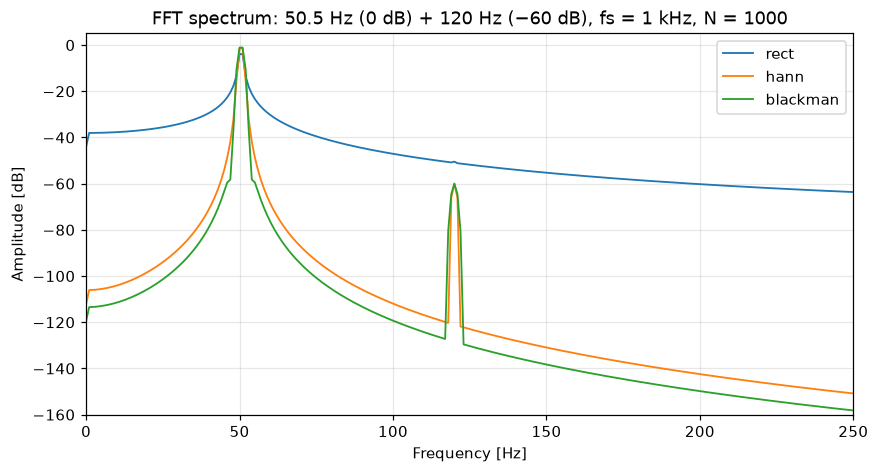
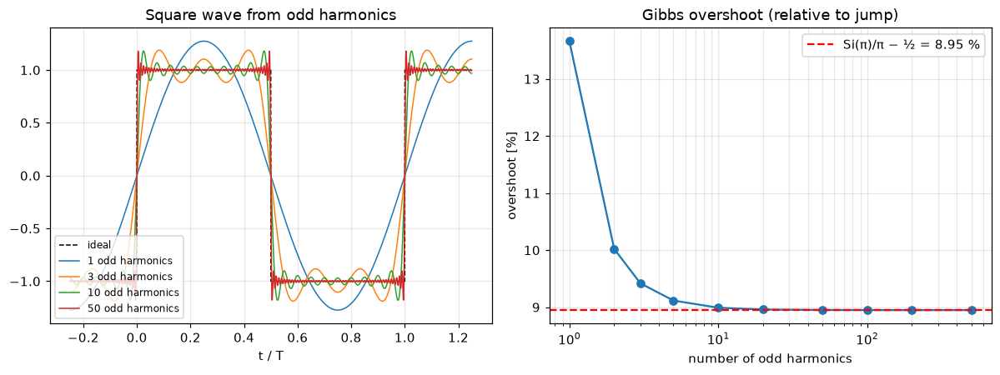
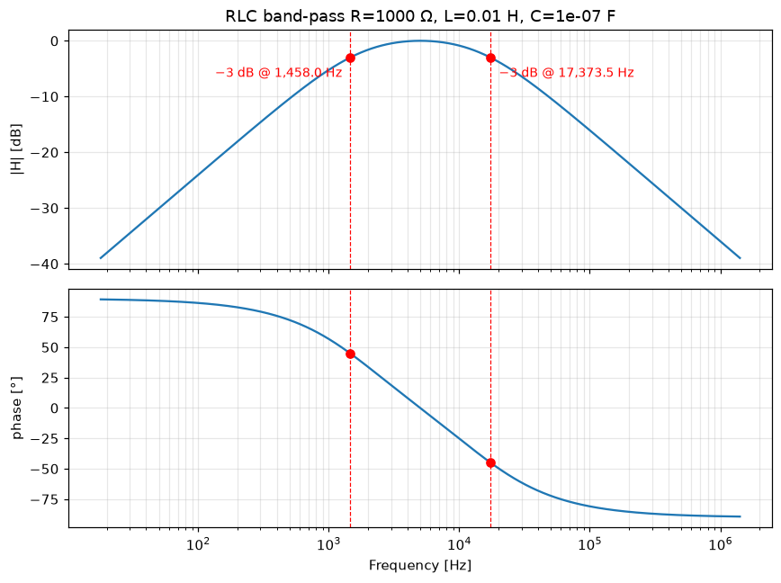
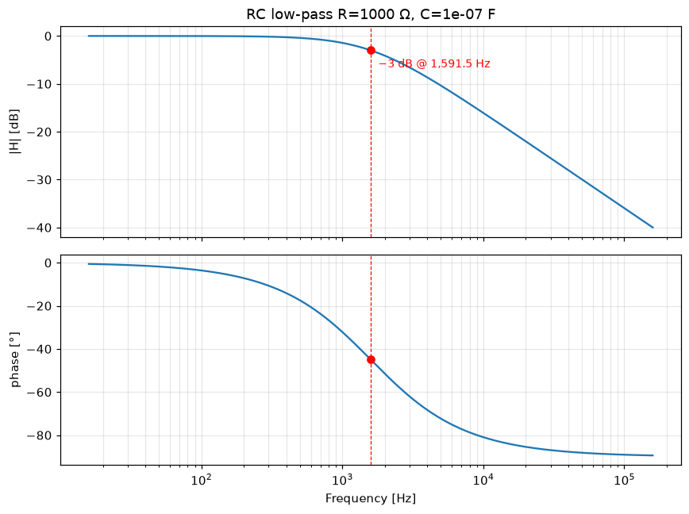
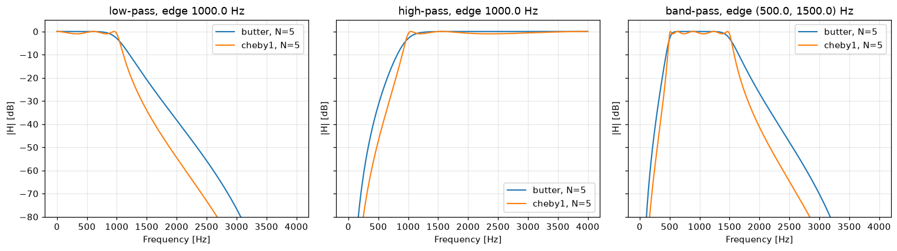
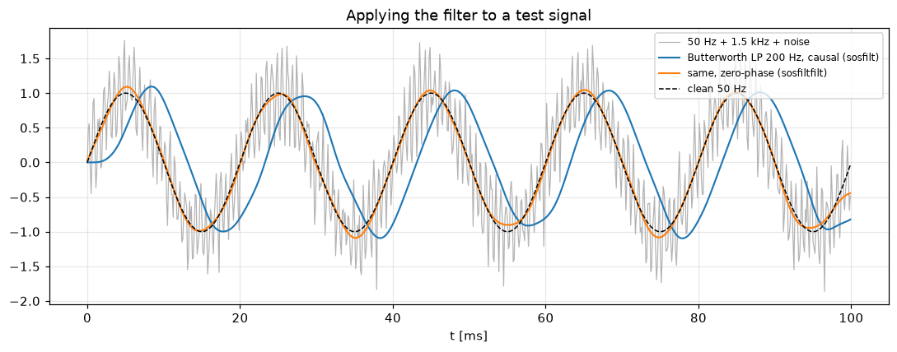
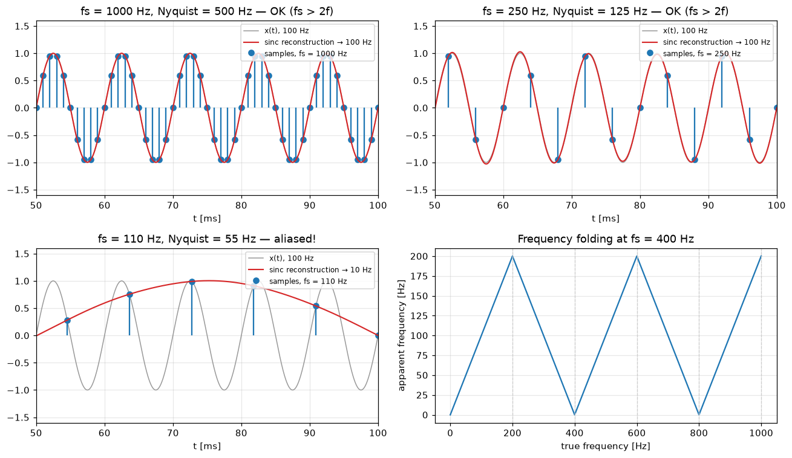
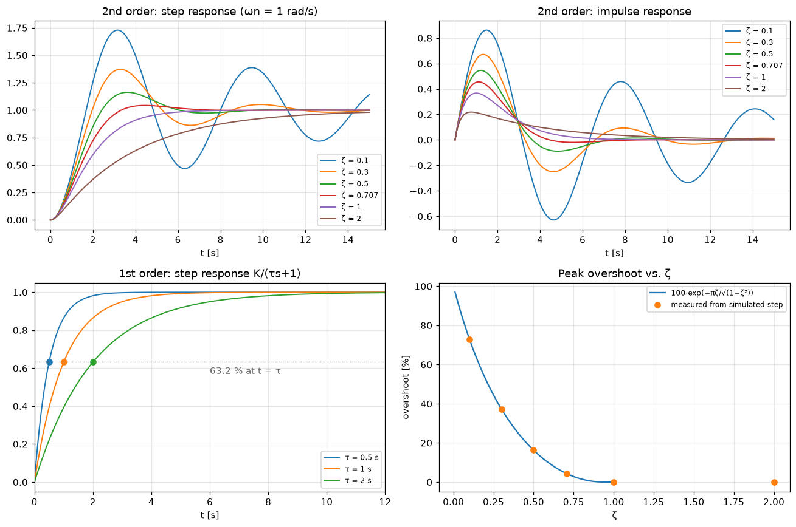

# 🚀 ETech-Signal-Plot-Lab

Welcome to **ETech-Signal-Plot-Lab**! 🌌  
A Python playground for electrical engineering, signal processing, and system visualization. Explore, experiment, and visualize signals, circuits, filters, and more—all while leveling up your **NumPy** and **Matplotlib** skills. 📊✨

---

## 🧩 What You Can Do Here

- Generate and manipulate **signals**: sine, square, triangle, and noise waves 🎵  
- Explore **Fourier & Laplace** transforms and analyze system responses 🔍  
- Play with **modulation techniques**: AM, FM, PM, and demodulation 📡  
- Design and test **filters**: low-pass, high-pass, band-pass, band-stop ⚡  
- Simulate simple **circuits**: RC, RL, LC, RLC 🔌  
- Experiment with **control systems**: PID, step responses, Bode plots ⚙️  
- Create stunning **3D visualizations & animations** 🌠  

---

## 🛠 Why This Repo

This is not just a collection of scripts—it's your personal lab for **hands-on learning**. Perfect for:  

- 🧪 Practicing Python with real EE problems  
- 📈 Improving your data visualization skills  
- 🤖 Experimenting with signals, circuits, and controls  
- 🚀 Quickly prototyping and testing ideas  

---

## 📦 Getting Started

```bash
git clone https://github.com/Ri4ards2006/ETech-Signal-Plot-Lab.git
cd ETech-Signal-Plot-Lab
uv sync                      # numpy, scipy, matplotlib + pytest (Python ≥ 3.10)
uv run pytest                # 69 tests against analytic results
```

Without uv: `pip install numpy scipy matplotlib pytest` (the older scripts in
`src/`, `circuits/`, `comms/` additionally use `ipywidgets`).

---

## 🧮 Tested DSP modules (`signal_lab/`)

Importable modules: pure functions return NumPy arrays, plot helpers return a
Matplotlib `Figure`, nothing opens a window on import. Every module has an
example (`uv run python -m examples.<name>`, add `--save DIR` for PNGs) and
tests that compare against a closed-form result.

| Module | What | Checked against (tests/) |
|---|---|---|
| `fourier` | FFT amplitude spectrum, rect/Hann/Blackman window, dB scale, `rfftfreq` axis; square wave from odd harmonics, Gibbs overshoot | peak bin & amplitude, Δf = fs/N, 0 / −20 dB, leakage ordering, overshoot → Si(π)/π − ½ = 8.95 % |
| `bode` | RC / RL low/high-pass, series RLC band/low-pass from R, L, C; magnitude + phase, exact −3 dB markers | f_c = 1/(2πRC), R/(2πL), −45° at f_c, 20 dB/dec, f₀ = 1/(2π√LC), B = R/(2πL), \|H(f₀)\| = Q |
| `filters` | Butterworth / Chebyshev I low/high/band-pass (`scipy.signal`, SOS), apply causal or zero-phase | bilinear Butterworth \|H\|², −3.01 dB at f_c, Chebyshev ripple = r_p and −r_p at the edge, tone recovery |
| `sampling` | Nyquist check, alias folding, sinc reconstruction; **interactive fs slider** | 900 Hz @ 1 kHz → 100 Hz (samples, FFT peak, reconstruction) |
| `systems` | 1st/2nd-order step & impulse responses, damping ratio ζ, step metrics | closed forms for ζ < 1, = 1, > 1; 63.2 % at τ; overshoot e^(−πζ/√(1−ζ²)); t_s = τ·ln 50 |

### Example plots

| | |
|---|---|
|  |  |
|  |  |
|  |  |
|  |  |

Regenerate: `for m in fourier_demo bode_demo filters_demo sampling_demo systems_demo; do uv run python -m examples.$m --save docs/img; done`

CI (`.github/workflows/tests.yml`) runs the tests with warnings as errors on
Python 3.10 and 3.13 and uploads the example plots as an artifact.
See [AUDIT.md](AUDIT.md) for the state of the older scripts and
[docs/PORTFOLIO.md](docs/PORTFOLIO.md) for a project summary (EN/DE).

✨ Let's Explore the Signal Universe! 🌌

Every plot is a step closer to mastering the world of signals, systems, and visualization. 🌠📊
